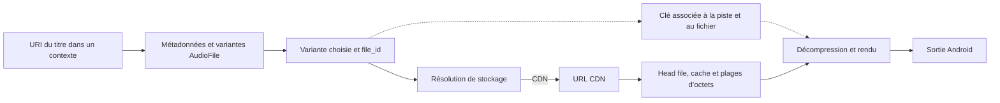

# Spotifeur — enquête sur Spotify Android

Analyse du paquet fourni `com.spotify.music` **9.2.0.26**, build **148373686**, au 3 novembre 2026. Périmètre musical : session, recherche, titres, artistes, albums, playlists, bibliothèque et lecture. L’analyse porte sur les binaires livrés et les interfaces publiques documentées.

- [Validation sur le Pixel](docs/validation-pixel.md) — lecture locale et catalogue, seek, transition naturelle, playlist communautaire, hors connexion et perte de réseau, avec tampon mesuré, preuves réseau et comparaison de builds.
- [Intégration SDK Spotify et Web API](docs/sdk-spotify.md) — choix de Spotifeur, couverture fonction par fonction et correspondance avec les résultats de l’analyse.
- [Moteur audio et transfert CDN](docs/audio-natif.md) — état du lecteur, variantes, chemin du résolveur, contrat Protobuf, cache, préchargement, clés et sortie Android.
- [Catalogue et bibliothèque](docs/catalogue.md) — appels DEX vérifiés, hydratation Extended Metadata, Playlist4 et synchronisation Collection v2.
- [Session et accès Spotify](docs/session-et-acces.md) — démarrage Android, Login5, ClientToken et attestation Play Integrity, Webgate, pub/sub, Spotify Connect (état et contrôle des appareils) et portée des API publiques.
- [Preuves REA](docs/preuves/) — inventaire de l’APKM et relevés ciblés sur le DEX.

## Parcours de lecture

Le schéma rapproche plusieurs chemins statiques du build. Les pointillés signalent que le trajet exact de la clé jusqu’au décodeur reste ouvert. Le résolveur possède aussi des réponses `STORAGE` et `RESTRICTED`, dont les branches d’exécution complètes n’ont pas été suivies.

Le client sépare l’URI de catalogue, l’identifiant du fichier et l’instance de lecture. Une même piste peut déclarer plusieurs fichiers selon le format. Le résolveur natif construit un chemin relatif à partir d’un mode de lecture ou de préchargement, d’un entier et d’un identifiant de fichier hexadécimal. La réponse Protobuf peut porter plusieurs URL CDN. Des procédures natives construisent ensuite des demandes par plage ou par fichier entier et contrôlent la réponse. Le lecteur peut préparer le début d’un titre et sa clé avant la transition. [Détails et adresses](docs/audio-natif.md).

La recherche et les fiches passent par des interfaces distinctes du plan audio. Les playlists sont des listes révisées, avec pagination et capacités. La bibliothèque utilise des ensembles, un curseur de page et un jeton de synchronisation. Les formats et les appels documentés appartiennent à ce build. Leur acceptation et leur stabilité côté serveur restent à vérifier. [Contrats de catalogue](docs/catalogue.md).

## Le protocole natif, plan par plan

L’objectif est que Spotifeur parle aux services internes comme le client officiel, sans Client ID ni App Remote. L’analyse distingue deux plans.

**Plan données et session.** La résolution du catalogue (`storage-resolve/v2`), la recherche, les fiches, la bibliothèque, les playlists et les files passent par des contrats internes documentés dans les notes [catalogue](docs/catalogue.md) et [session](docs/session-et-acces.md). La session démarre par Login5 sur `login5.spotify.com/v3|v4/login` et un jeton client sur `clienttoken.spotify.com`. Le défi d’accès est un **hashcash** (preuve de travail) dont le mécanisme est public et que des projets comme librespot savent résoudre. Ce plan est rejouable avec les droits d’un compte Premium.

**Plan autorisation.** L’octroi des jetons s’accompagne d’une **attestation d’intégrité d’application** (`AppIntegrityLogger`, `spotify::drm::collectFridaFeatures`) et de jetons liés par **DPoP**. Côté audio, le binaire porte **deux générations** : un chemin hérité où le moteur déchiffre lui‑même (modèle que reproduit librespot), et un chemin **Widevine** (fMP4 CBCS/CENC‑CTR, licence consommée dans le DRM de la plateforme). Les essais sur le Pixel montrent que la **musique** jouée — catalogue à froid et Lossless compris — a emprunté le chemin hérité : décodeurs AAC/MP3 ordinaires, aucune session Widevine. Le Widevine du binaire ne s’est pas engagé pour ces lectures.

**Synthèse.** Les appels de données et de session, et le déchiffrement de la musique standard, suivent des modèles reproductibles. L’**attestation d’intégrité** Play Integrity intervient à l’octroi des jetons, produite par les services Google et le TEE de l’appareil. Un chemin Widevine subsiste dans le binaire pour un contenu non identifié (vidéo, sorties particulières). Détail des maillons — [clé, Widevine et observation appareil](docs/audio-natif.md#4-autorisation-média-et-décodage), [défi et attestation](docs/session-et-acces.md#couche-de-défi-et-dattestation), [mesures sur le Pixel](docs/validation-pixel.md#déchiffrement-observé-en-process-plutôt-que-widevine). Les notes conservent aussi, à titre de comparaison, le périmètre d’App Remote et de la Web API publiques. [librespot](https://github.com/librespot-org/librespot), [Spotify Android SDK](https://developer.spotify.com/documentation/android).

## Identité et vérification du paquet

| Artefact | SHA-256 |
| --- | --- |
| APKM fourni | `186e251a3d4998b0a8182916c55be2ade2d7b9444efc6e8e8cc79bde08ed1ee2` |
| `base.apk` | `cc165669d31851b1193cae7d54c9261579c431b432080970f460704d06e4612f` |
| `split_config.arm64_v8a.apk` | `d9360d4b9a29a46c752b61b8c6409c67c4aa78ca07ca9af1f768af950b0155bd` |
| `split_config.en.apk` | `a6e91962543f23478c59d70a19bd00637b9ab03d4a321480cea50c90b1d281ff` |
| `split_config.xxhdpi.apk` | `371b587b87fde2cb5078d78fb3cd13a239a059149a22918372034e499944b800` |
| `liborbit-jni-spotify.so` | `2353f26f5e174917b36c3c9de4538717c6348cc0bacf8b2c094f22d1447538e2` |

REA identifie l’APKM comme ZIP et en recense dix entrées. L’inventaire est conservé sous `ev_e01d2bf12175babf129f87704f2b2b9ed2daab291269e83614d0d6aa64eb1b72`. Le manifeste principal identifie le paquet et la version et déclare un SDK minimum 24 et cible 37. Le split ARM64 porte la bibliothèque Orbit. Le split principal porte quinze DEX. `apksigner verify --verbose --print-certs` (Android Build Tools 36.0.0) a validé les quatre APK avec le même certificat signataire SHA-256 `6505b181933344f93893d586e399b94616183f04349cb572a9e81a3335e28ffd`. Cette vérification lie les splits entre eux et à leur signature incluse.

Pour reproduire l’analyse, extraire les quatre APK dans un dossier de travail distinct, contrôler les hachages, puis suivre les commandes de chaque note. Les preuves REA Android ont été obtenues avec REA 6.7.0, JADX Headless MCP 0.7.1 et JDK 21. Les requêtes ciblées qui ont dépassé le délai sur l’APK complet ont été ramenées à des projections d’un DEX ou vérifiées avec `apkanalyzer`. Les projections contiennent le manifeste original et un DEX original renommé `classes.dex`. Les relations inter-DEX sont contrôlées sur le paquet complet. L’analyse native REA/Hopper a dépassé le délai sur un écran de premier lancement. Le relevé natif repose sur LLVM, les relocations ELF, les références ARM64 et les descripteurs Protobuf décodés. La session REA a ensuite été fermée avec succès.

## Couverture et vérifications restantes

| Question | État à l’issue de l’enquête |
| --- | --- |
| Provenance locale, composition, versions et cohérence des signatures | Vérifiées sur l’APKM et les quatre APK. |
| Session et transports | Séquences d’initialisation DEX et plusieurs routes natives confirmées. Acceptation serveur et ordre de négociation à vérifier. |
| Recherche, titres, albums et artistes | Interfaces, appels et modèles confirmés. Trajet exact de chaque écran album ou artiste et données par compte à vérifier. |
| Playlists personnelles, communautaires et bibliothèque | Modèles de liste, révisions, capacités, pages et deltas confirmés. Visibilité et comportement serveur au cas par cas à vérifier. |
| Résolution et CDN | Construction de la route, schéma de réponse, branches par plage et validation HTTP confirmés. Requêtes complètes, choix du CDN, taille des plages et règles de reprise à vérifier. |
| Autorisation média, codecs et rendu | Modules et plusieurs branches de lecture confirmés. Protocole de clé, sélection du format et chemin de sortie par appareil à vérifier. |
| Édition de la file, téléchargements et dossiers | Contrats internes et sites d’appel ciblés confirmés. Conditions serveur, états en exécution et disponibilité pour un tiers à vérifier. |
| Lecture sur appareil | Spotify 9.1.94.1929 vérifié sur le Pixel pour la lecture à froid, le déplacement dans un titre, la commande Suivant, une playlist tierce et un titre téléchargé en mode hors connexion de l’app. La transition naturelle (0,48 s de `BUFFERING`, sortie audio continue) et une perte de réseau limitée à Spotify ont aussi été mesurées. Le client télécharge une rafale d’environ 13 Mo au lancement, soit environ 11 min à 160 kbit/s, puis se tait. La lecture a tenu 641 s sans réseau et a repris 37 s après son retour. [Validation](docs/validation-pixel.md). |

La [validation sur le Pixel](docs/validation-pixel.md) a couvert le titre à froid, le déplacement, la transition naturelle, la perte de réseau limitée à Spotify et le hors-ligne natif. Il reste à corréler finement la commande, la résolution, le premier octet et le premier échantillon rendu, et à mesurer le seuil de rechargement du tampon. Une capture passive attribue les volumes et les connexions à l’application. Elle ne lit ni les en-têtes ni les charges TLS. Les compteurs Perfetto par paquet sous-estiment les volumes d’environ 3,6 fois sur ces rafales, les tailles absolues proviennent de `wlan0`. La preuve du contrat réseau détaillé demanderait des traces applicatives autorisées ou une documentation de l’interface concernée. Aucune requête de lecture vers les services privés n’a été rejouée pendant cette enquête.
